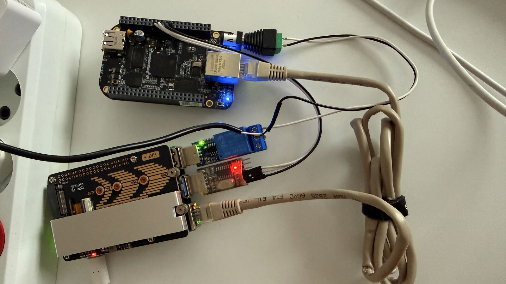

# beaglebone-rf-testsuite

Hardware-in-the-Loop test automation for a BeagleBone Black, written in Robot Framework and driven from a Raspberry Pi 5.


This is a Robot Framework test suite for a BeagleBone Black, driven from a Raspberry Pi 5 over serial and Ethernet, with a USB relay switching the board's power. It power-cycles the board with the relay, watches the cold boot over UART, inspects the U-Boot environment mid-boot, brings the board up on the network, checks its running state over SSH, and runs five consecutive power cycles to check that the boots succeed in a consistent time — producing a Robot Framework report and log on each run. A Jenkins pipeline on the same Raspberry Pi runs the suite on the real board and publishes the results (see [CI (Jenkins)](#ci-jenkins)).

Every test runs against physical hardware: a real BeagleBone Black connected to a real Raspberry Pi over UART, a direct Ethernet link, and a relay-switched power supply. There is no emulation and no mocked transport layer.

|                        |                                                                   |
| ---------------------- | ----------------------------------------------------------------- |
| **Device Under Test**  | BeagleBone Black — TI AM335x, single-core Cortex-A8, 512 MB RAM   |
| **Test Host**          | Raspberry Pi 5 — Ubuntu 26.04 LTS, ARM64, Python 3.14              |
| **Framework**          | Robot Framework 7.4.2, keyword-driven, custom `.resource` keyword files and one custom Python library (`RelayPower`) |
| **Transports**         | Serial UART (115200 8N1) · direct peer-to-peer Ethernet · SSH      |
| **Power Control**      | USB-serial relay (CH340) in the DUT's positive 5 V lead, driven over pyserial |
| **Boot Image**         | BeagleBoard.org Debian Buster IoT Image 2020-04-06 — U-Boot 2019.04-00002-g31a8ae0206, kernel 4.19.94-ti-r42 |
| **Coverage**           | 36 test cases across 6 suites                                      |
| **CI**                 | Jenkins pipeline (`Jenkinsfile`) on a build agent running directly on the Raspberry Pi |

---

## Table of Contents

- [Overview](#overview)
- [The Test Bench](#the-test-bench)
- [Why Two Transports](#why-two-transports-serial--ethernet)
- [Power Control](#power-control)
- [Repository Structure](#repository-structure)
- [Architecture](#architecture)
- [Test Suite](#test-suite)
- [Engineering War Stories](#engineering-war-stories)
- [Getting Started](#getting-started)
- [Reports](#reports)
- [CI (Jenkins)](#ci-jenkins)
- [Testing Philosophy](#testing-philosophy)
- [Limitations](#limitations)
- [Tech Stack](#tech-stack)
- [License](#license)
- [Author](#author)

---

## Overview

This project is a keyword-driven Robot Framework test suite that validates a BeagleBone Black end-to-end: from the moment a relay applies power, through the U-Boot and Linux boot chain, across the network stack, and into a live SSH session that checks the system's actual health — memory, disk, load, running services, and log output. A final suite repeats the power cycle five times to check that the boots succeed and take a consistent time.

A few things about how this suite is built:

- **It's organized by dependency, not by convenience.** Suites are ordered bottom-up: serial boot monitoring first, then U-Boot console inspection, then network, then SSH, then log analysis, then reboot stress. Each layer only depends on layers already proven to work, so a failure surfaces at the layer that actually caused it instead of several layers downstream.
- **It's structured to extend.** Adding a new test category follows the same pattern as the existing suites: one new `.resource` file, one new `.robot` file, and any new thresholds added to `config/constants.py`.

---

## The Test Bench


```
┌──────────────────────┐                                  ┌──────────────────────┐
│   Raspberry Pi 5     │                                  │   BeagleBone Black   │
│   Ubuntu 26.04 ARM64 │                                  │   Debian Buster      │
│   Python 3.14        │                                  │   TI AM335x          │
│                      │                                  │                      │
│   10.0.0.1           ├────── direct P2P Ethernet ───────┤   10.0.0.2           │
│   /dev/bbb-uart      ├──────── UART, 115200 8N1 ────────┤   serial console     │
│                      │                                  │                      │
│   /dev/relay0        │                                  │   5 V power jack     │
└──────────┬───────────┘                                  └───────────┴──────────┘
           │ USB, relay control only                                  │
┌──────────┴───────────┐                 +5 V, switched by the relay  │
│      USB relay       │                                              │
│   (CH340 module)     ├── NC ────────────────────────────────────────┘
│                      │
│                      ├── COM ── +5 V from the supply
└──────────────────────┘
```

The UART link uses the BBB's J1 debug header at 3.3 V TTL logic levels. Only three of its pins are connected on the board: pin 1 (GND) to the adapter's ground, pin 4 (RXD) to the adapter's TX line, and pin 5 (TXD) to the adapter's RX line. The adapter's VCC line is not wired — the board is powered separately through the relay-switched 5 V supply (see [Power Control](#power-control)) — and the adapter must be a 3.3 V one: 5 V logic levels can damage the board's UART pins.

The Raspberry Pi is the test runner — it never runs test logic on the DUT itself. Every check is driven from the Pi, over one of the two transports above, and asserts on what comes back. The relay is a control channel only: it switches power and carries no test data.

---

## Why Two Transports (Serial + Ethernet)?

Because they see different, non-overlapping parts of the board's life:

```
SPL → U-Boot → Linux Kernel → Root Filesystem → login: prompt
```

The serial console provides visibility from the SPL stage onward, all the way through to the login prompt. Ethernet and SSH don't exist yet for most of that chain — the network stack only comes up once the kernel has mounted the root filesystem and systemd has started the relevant services. A board that hangs in U-Boot, panics mid-kernel-boot, or fails to mount its root filesystem is invisible to a ping or an SSH test — it just looks like "unreachable," with zero diagnostic value.

That's why serial is treated as the source of truth for boot health, and why the serial boot and U-Boot suites run before the network-based ones — serial can see failures earlier in the chain that a network test would only see as a silent timeout.

---

## Power Control

The DUT's 5 V supply runs through a 1-channel USB-serial relay module (CH340 interface). The relay's COM and NC contacts are in series with the positive lead between the supply and the board's power jack; NO is unused and ground is never switched. With the coil released the board is powered; energizing the coil opens the contact and cuts power.

`libraries/RelayPower.py` is a small Python library over pyserial that knows only two actions, `Relay Energize` and `Relay Release`. Each sends a 4-byte command at 9600 baud to `/dev/relay0` (a udev symlink, see [Getting Started](#getting-started)); the port and the command bytes are set in `config/constants.py`. The library opens the port per command and has no notion of polarity. `resources/power_keywords.resource` adds that meaning and builds the sequences the suites use:

| Keyword | Behavior |
|---|---|
| `Power Off DUT` / `Power On DUT` | Energize / release the coil |
| `Graceful Power Cycle DUT` | Logs in over the serial console, runs `poweroff`, waits for the `Power down` marker (up to 60 s), cuts power, holds 5 s, restores power; returns without capturing the console. If the login fails or the marker does not appear, it logs a WARN and cuts power anyway |
| `Cold Boot DUT` | `Graceful Power Cycle DUT`, then captures the console from the first byte after power-on until the `login:` prompt; returns the log and the elapsed seconds |
| `Hard Power Cycle DUT` | Cuts and restores power with no shutdown |
| `Restore Power And Close Serial` | Suite teardown of the serial boot monitoring and stress suites: restores power whatever happened in the suite, then closes the serial port |

After power-on the console is not nudged with Enter for the first 30 s (`COLD_BOOT_NUDGE_AFTER_SEC`): the U-Boot autoboot delay is 0 and a keypress during startup interrupts autoboot — the U-Boot suite relies on exactly that — so an early nudge would stop the board at the U-Boot prompt.

A manual run of `Hard Power Cycle DUT` on this bench produced `rootfs: recovering journal` followed by `rootfs: clean` in the next boot log, and the board reached the login prompt in 57 s. The boot logs checked from graceful runs — the serial suite's and the five stress cycles' — contain no `recovering journal`, and `Root Filesystem Should Be Clean` fails if that line ever appears, which also exposes a graceful shutdown that fell back to a plain power cut.

---

## Repository Structure

```text
beaglebone-rf-testsuite/
├── config/
│   ├── constants.py               # shared, non-secret thresholds, patterns & relay settings — committed
│   ├── secrets.example.py         # template with dummy values — committed
│   └── secrets.py                 # SSH credentials & bench connection settings — gitignored, never committed
├── libraries/
│   └── RelayPower.py              # pyserial relay driver: energize / release the coil
├── resources/
│   ├── serial_keywords.resource   # low-level UART interaction, console login, boot log capture
│   ├── power_keywords.resource    # relay power on/off, graceful & hard power cycle, cold boot capture
│   ├── uboot_keywords.resource    # relay power cycle + U-Boot autoboot interrupt + printenv inspection
│   ├── network_keywords.resource  # ping / ARP helper keywords
│   ├── ssh_keywords.resource      # shared SSH session + parsing keywords
│   ├── log_keywords.resource      # dmesg / journalctl helper keywords
│   └── stress_keywords.resource   # repeated cold-boot cycles and their per-cycle results
├── tests/
│   ├── serial/
│   │   └── boot_monitoring_test.robot
│   ├── uboot/
│   │   └── uboot_console_test.robot
│   ├── network/
│   │   └── network_test.robot
│   ├── ssh/
│   │   └── ssh_test.robot
│   ├── logs/
│   │   └── log_test.robot
│   └── stress/
│       └── stress_test.robot
├── results/                       # generated log.html / report.html / output.xml / boot logs — gitignored, only .gitkeep is tracked
├── .gitignore
├── Jenkinsfile                    # declarative pipeline: environment check, venv, dry run, full run, result publishing
├── LICENSE
├── README.md
└── requirements.txt
```

**Why secrets are split from constants:** `config/constants.py` holds everything safe to publish — fatal-pattern lists, timing thresholds, expected board and U-Boot values, the DUT address used by the network suite (`BBB_IP_ADDRESS`), and the relay's device name and command bytes. `config/secrets.py` holds what is specific to one bench or must not be published — the SSH credentials (`BBB_SSH_USER`, `BBB_SSH_PASSWORD`) together with the DUT's connection settings for the serial and SSH suites (`BBB_IP`, `SERIAL_PORT`, `SERIAL_BAUDRATE`) — and is excluded via `.gitignore`. Only `config/secrets.example.py`, with placeholder values, is committed.

---

## Architecture

Each `.robot` test file sits on top of the `.resource` keyword files for its layer — `boot_monitoring_test.robot` uses `serial_keywords.resource` and `power_keywords.resource`, `uboot_console_test.robot` uses `uboot_keywords.resource`, `stress_test.robot` uses `stress_keywords.resource` (which builds on the serial, power and log keywords), `ssh_test.robot` uses `ssh_keywords.resource`, and so on. Access to the serial port and the relay goes through `.resource` keywords only: test cases never call SerialLibrary keywords or the `RelayPower` library directly, while the SSH-based suites run their commands with SSHLibrary's `Execute Command` on the shared session opened by `ssh_keywords.resource`. Board-specific values — thresholds, the U-Boot version pattern, the expected board name and U-Boot environment values, relay command bytes — live in `config/constants.py`, and connection settings and credentials live in `config/secrets.py`; both are imported into the resource files rather than hardcoded into individual keywords. The few log markers that only one test uses (`Boot SPL`, `eth0: MII MODE`, `rootfs: clean`) stay as literals in that test. Session state (the open SSH connection, the captured boot log) is set once in Suite Setup as a suite variable and read by every test case in that suite, rather than passed as arguments between tests.

---

## Test Suite

**36 test cases across six suites**, ordered by dependency.

### Serial / Boot Monitoring — 7 tests
`tests/serial/boot_monitoring_test.robot`

Shuts the DUT down over the serial console, cuts and restores its power with the relay, and watches the cold boot over UART from the first SPL byte to the Linux login prompt — entirely independent of network or SSH.

- Boot Log Should Be Captured (the capture starts at the SPL banner and reaches the login prompt)
- Boot Log Should Contain No Critical Failures (none of the fatal patterns `Kernel panic`, `Oops`, `Call Trace`, `Unable to mount root fs`, `Segmentation fault`)
- Boot Time Should Be Within Threshold (≤ 72 s, calibrated with a 25% margin over a 57.4 s measured cold boot, relay power-on to login prompt)
- U-Boot Banner Should Match Expected Version
- Board Should Be Identified As BeagleBone Black
- Network And Storage Drivers Should Initialize
- Root Filesystem Should Be Clean (`rootfs: clean` is present and `rootfs: recovering journal` is not)

### U-Boot Console Validation — 7 tests
`tests/uboot/uboot_console_test.robot`

Power-cycles the DUT with the relay, interrupts autoboot right after power is applied, inspects the running U-Boot environment via `printenv`, then resumes normal boot. Entirely read-only — no environment variable is ever written or saved. Its Suite Teardown always releases the relay and closes the serial port, and writes `boot` only while the board is still held at the `=>` prompt.

- Autoboot Should Be Interruptible And Reach U-Boot Console
- Board Identity Should Match Expected Values
- Ethernet MAC Address Should Be Set And Valid
- Boot Command Should Use Standard Distro Boot Sequence
- Kernel And FDT Load Addresses Should Match Expected Memory Map
- Serial Console Should Be Configured On Expected UART
- DUT Should Resume Normal Boot After Console Inspection (login prompt within 72 s, timed from the `boot` command)

### Network Layer — 3 tests
`tests/network/network_test.robot`

Validates basic IP connectivity between the Raspberry Pi and the DUT over the direct peer-to-peer Ethernet link.

- BeagleBone Should Respond To Ping (4 packets, zero packet loss tolerance)
- BeagleBone Should Maintain Stable Connection Under Sustained Ping Load (120 packets, ≤ 2% loss tolerance)
- Host Neighbor Table Should Show A Valid Entry For BeagleBone (a resolved entry with a well-formed MAC address, not `FAILED` or `INCOMPLETE`)

### SSH / System Validation — 8 tests
`tests/ssh/ssh_test.robot`

Opens a single shared SSH session in Suite Setup and checks the DUT's live running state. Connection failures are captured rather than raised, so the first test reports the cause clearly and the rest skip cleanly instead of failing on an opaque SSHLibrary error.

- SSH Login Should Succeed With Root Credentials
- System Uptime Should Be Positive And Sane (`/proc/uptime` is above 0 and below 30 days)
- Kernel Release Should Match The Expected Version (`uname -r` equals `EXPECTED_KERNEL_RELEASE`, the release U-Boot reports loading)
- Root Filesystem Usage Should Be Below Threshold (< 90%)
- Available Memory Should Be Above Minimum Threshold (> 50 MB)
- System Load Average Should Be Within Healthy Range (1-minute average < 3.0)
- Critical Services Should Be Active (`ssh`, `connman`)
- Device Should Not Have Rebooted Unexpectedly During The Test Session (uptime has not dropped since the session was opened, so it covers the duration of that session only)

### Log Analysis — 6 tests
`tests/logs/log_test.robot`

Reads the kernel ring buffer (`dmesg`) and the systemd journal (`journalctl`) over the same SSH session pattern, catching faults that occur after boot completes and signs of an unclean prior shutdown.

- SSH Session Should Be Available For Log Analysis (fails with the connection error if the session could not be opened; the tests below then skip, so an unreachable board cannot produce a green run)
- Dmesg Should Contain No Critical Kernel Failures (the same fatal patterns, checked on the live kernel ring buffer)
- Dmesg Should Not Contain Out Of Memory Killer Events (`Out of memory`, `oom-killer`, `Killed process`)
- Current Boot Journal Should Not Exceed Error Threshold (≤ 12 entries at priority `err` or higher: 9 measured on a real boot plus a 25% margin)
- Previous Boot Should Have Ended With A Clean Shutdown Sequence (an orderly-shutdown marker in the tail of the previous boot's journal; skipped when there is no previous boot)
- Journal Disk Usage Should Be Below Threshold (< 50 MB)

### Stress / Reboot Cycles — 5 tests
`tests/stress/stress_test.robot`

Suite Setup runs five consecutive power cycles with the relay — graceful shutdown over serial, power cut, power restored, then a capture from the first byte of the new boot — and every test analyzes a different aspect of that same dataset. A cycle that never reaches the login prompt is recorded as failed and its log is kept; a relay or serial-port error is stored in that cycle's result and the remaining cycles still run. On this bench a cycle takes about 73 s end to end, 57 s of it from power-on to the login prompt, so the suite's setup takes about six minutes.

- Reboot Cycle Success Rate Should Meet Minimum Threshold (≥ 80% of the cycles reach the login prompt)
- Boot Time Should Stay Within Threshold On Every Successful Cycle (≤ 72 s)
- Boot Time Variance Should Remain Low Across Cycles (slowest minus fastest boot ≤ 10 s)
- No Reboot Cycle Should Introduce New Critical Kernel Failures (none of the fatal patterns appears in the boot log of any successful cycle)
- Every Reboot Cycle Should Show A Fresh U-Boot Banner And Correct Board Identity

---

## Engineering War Stories

Real bugs hit while building this suite, each with a false start before the actual root cause.

**1. The `PermitRootLogin` default that wasn't disabled**
Root login via SSHLibrary/paramiko kept failing, even though the identical password worked fine in a manual `ssh` session. The commented-out `#PermitRootLogin prohibit-password` line in `sshd_config` looks like a disabled setting — it isn't. `prohibit-password` is OpenSSH's compiled-in default, and the comment merely documents it. Fix: explicitly set `PermitRootLogin yes` and `PasswordAuthentication yes`, then restart `ssh`.

**2. The `tda998x` false positive**
A naive `"error" not in dmesg` check failed on every single boot, including healthy ones. The HDMI driver `tda998x` logs `Error applying setting` simply because no HDMI cape is attached to this headless board — cosmetic noise, not a fault. Fix: match a short list of genuinely fatal patterns (`CRITICAL_FAILURE_PATTERNS`) instead of a blanket string search, and judge the journal by a ceiling on error-level entries calibrated on a real boot (9 baseline entries, limit 12). `KNOWN_BENIGN_WARNINGS` in `config/constants.py` lists the known noise as a reference only; no test filters on it.

**3. The SerialLibrary hexlify trap**
Serial reads were coming back as unreadable hex strings instead of text. `robotframework-seriallibrary` 0.4.3 defaults to hexlify encoding unless told otherwise, and the correct read keyword is `Read All Data`, not the more discoverable `Read Data`. `Read All Data` is also non-blocking, so polling loops need an explicit `Sleep` between reads. Fix: `Library SerialLibrary encoding=ascii`, plus a poll-and-sleep loop.

**4. ConnMan silently reverting the DUT's static IP**
The BeagleBone's IP address would reset after every reboot despite being set via `/etc/network/interfaces`. ConnMan owns network configuration on this image and silently overrides that file on its own schedule. Fix: configure the static IP through `connmanctl config --ipv4 manual` instead.

**5. cloud-init vs. NetworkManager on the Raspberry Pi host**
The Pi's own Ethernet interface would occasionally lose its static IP. Two systems were both trying to manage the same interface: cloud-init's `systemd-networkd` config and NetworkManager. Fix: disable cloud-init's network management via a drop-in `.cfg` file and let NetworkManager own the interface exclusively.

**6. Two USB-serial adapters with the same USB ID**
The UART adapter was assumed to be an FTDI device, which would have allowed telling it apart from the relay module by vendor and product ID. `udevadm` showed that both are CH340 (`1a86:7523`), so no vendor/product rule can distinguish them — and the `/dev/ttyUSB*` numbers are handed out in enumeration order, which is no stable way to address either one. Fix: unplug the relay to see which node it owns, then match on the one property that differs, `ID_MODEL` (`USB_Serial` for the relay, `USB2.0-Serial` for the UART adapter), and give each adapter a stable symlink: `/dev/relay0` and `/dev/bbb-uart`.

---

## Getting Started

1. **Wire up the bench.** Connect the Raspberry Pi and BeagleBone Black via a direct Ethernet cable and a 3.3 V TTL USB-to-serial adapter to the BBB's J1 debug header, and connect the relay module to a Pi USB port with its COM and NC contacts in series with the positive lead of the DUT's 5 V supply — see [The Test Bench](#the-test-bench) and [Power Control](#power-control).
2. **Clone and set up the environment.**
   ```bash
   git clone https://github.com/FoxCraftPlace/beaglebone-rf-testsuite.git
   cd beaglebone-rf-testsuite
   python3 -m venv venv
   source venv/bin/activate
   pip install -r requirements.txt
   ```
3. **Name the USB-serial devices.** Both adapters on this bench are CH340 with the same USB ID, so the udev rules match on `ID_MODEL` — adjust the values to what `udevadm info` reports for your adapters. The rules give the `dialout` group access to both ports, so the user running the tests must be a member of it (`sudo usermod -aG dialout $USER`, then log in again).
   ```bash
   for d in /dev/ttyUSB*; do echo "== $d"; udevadm info -q property -n "$d" | grep -E '^(ID_VENDOR_ID|ID_MODEL_ID|ID_MODEL)='; done
   sudo tee /etc/udev/rules.d/99-bench.rules <<'EOF'
   SUBSYSTEM=="tty", ENV{ID_VENDOR_ID}=="1a86", ENV{ID_MODEL}=="USB_Serial", SYMLINK+="relay0", MODE="0660", GROUP="dialout"
   SUBSYSTEM=="tty", ENV{ID_VENDOR_ID}=="1a86", ENV{ID_MODEL}=="USB2.0-Serial", SYMLINK+="bbb-uart", MODE="0660", GROUP="dialout"
   EOF
   sudo udevadm control --reload-rules && sudo udevadm trigger --subsystem-match=tty
   ls -l /dev/relay0 /dev/bbb-uart
   ```
4. **Configure secrets.**
   ```bash
   cp config/secrets.example.py config/secrets.py
   ```
   Edit `config/secrets.py` with the DUT's address and real credentials, and set `SERIAL_PORT` to `/dev/bbb-uart`. The account must be **root**: the serial login waits for the `#` shell prompt and runs `poweroff` without `sudo`.
5. **Run a suite.** The serial, U-Boot and stress suites cut and restore the DUT's power through the relay.
   ```bash
   robot --outputdir results/ tests/serial/boot_monitoring_test.robot
   ```
   Or run everything in dependency order (about 11 minutes on this bench, about six of them in the stress suite):
   ```bash
   robot --outputdir results/ tests/serial tests/uboot tests/network tests/ssh tests/logs tests/stress
   ```
   Robot Framework runs the suites inside a directory alphabetically, so `tests/` alone would start with `logs`; naming the directories keeps the dependency order. A dry run, `robot --dryrun --outputdir /tmp/dry tests/`, checks that every keyword resolves without touching the board.

---

## Reports

Every run produces a standard Robot Framework `report.html` and `log.html` in `results/`, and the serial and stress suites save each captured boot log next to them as `boot_log_<unix time>.txt`. On this bench, the Raspberry Pi also runs nginx to serve the latest report over the local network, auto-updating as new runs complete — no separate publish step required.

---

## CI (Jenkins)

The `Jenkinsfile` in the repository root is a declarative pipeline that runs the suite on the real board. Jenkins itself runs in a Docker container on the Raspberry Pi; the pipeline executes on a permanent SSH agent on the Pi host (label `pi-host`, one executor), because the UART adapter, the relay and the direct Ethernet link are attached to the host, not to the container. The agent runs as the `jenkins` user, a member of `dialout`.

| Stage | What it does |
|---|---|
| Environment | Fails fast unless the agent user can read and write `/dev/bbb-uart` and `/dev/relay0` and can read the bench secrets file |
| Prepare | Clears the previous build's results, copies the bench secrets to `config/secrets.py` with mode 600, creates a virtualenv and installs `requirements.txt` |
| Dry run | `robot --dryrun` over all six suites — every keyword resolves, the board is not touched |
| Full suite | Runs the six suites in dependency order, exactly as in [Getting Started](#getting-started) |

When the run ends, the `post` block releases the relay so the DUT is left powered, counts the `WARN` entries in `output.xml`, archives `results/`, publishes the Robot Framework results on the build page and deletes the workspace copy of `secrets.py`.

The credentials never enter the repository or the Jenkins job configuration: the secrets file lives on the bench at `/etc/bbb-bench/secrets.py` (owner root, group `jenkins`, mode 640). A single executor and `disableConcurrentBuilds()` serialize pipeline runs on the one board. A full run on this bench passed 36 of 36 tests with 0 `WARN` entries.

---

## Testing Philosophy

- **Bottom-up dependency ordering** — serial → U-Boot console → network → SSH → log analysis → reboot stress (see [Overview](#overview)).
- **Serial as the source of truth for boot health** (see [Why Two Transports](#why-two-transports-serial--ethernet)).
- **Self-contained power cycling** — serial-based suites shut the board down over UART and cycle its power with the relay, with no SSH or network dependency.
- **Graceful by default** — power is cut after `poweroff`; if the shutdown fails, the suites log a WARN and cut power anyway. Cutting power with no shutdown is a separate keyword.
- **Power restored in teardown** — the suites that cut power restore it in Suite Teardown, so a failed run does not leave the DUT unpowered.
- **Single shared session per suite** — one connection opened in Suite Setup, reused by every test.
- **Capture, don't raise, on setup failure** — connection errors are stored as suite variables; the first test of each SSH-based suite fails with the stored error and the later tests skip, instead of failing on an opaque error.
- **Fatal patterns over naive string matching** (see War Story #2).

---

## Limitations

- The suite validates one specific board and image combination — a BeagleBone Black running the BeagleBoard.org Debian Buster IoT Image (2020-04-06), U-Boot 2019.04-00002-g31a8ae0206, kernel 4.19.94-ti-r42. Thresholds and expected values in `config/constants.py`, as well as the log markers the tests look for, are calibrated against this combination.
- No test case uses `Hard Power Cycle DUT`, so failure modes that surface only after sudden power loss are not asserted.
- The relay is commanded, but power is not measured: supply voltage and current are not read back.
- The Ethernet link is a static point-to-point connection (`10.0.0.1` / `10.0.0.2`) configured directly on both hosts; DHCP and other dynamic-addressing paths are not under test.
- CI runs on a single self-hosted agent on the bench itself: there is no hosted runner, and pipeline runs are serialized on the one board.
- Keyword logic is exercised through live runs against the physical board rather than isolated unit tests — correctness is validated by hardware asserting on it, not by mocked transport inputs.

---

## Tech Stack

| | |
|---|---|
| **Language**       | Python 3.14 |
| **Test framework** | Robot Framework 7.4.2 |
| **Libraries**       | robotframework-sshlibrary 3.8.0, robotframework-seriallibrary 0.4.3, paramiko 5.0.0, pyserial 3.5 (imported by `RelayPower` and by SerialLibrary, which does not declare it) — all pinned in `requirements.txt` |
| **Hardware control** | USB-serial relay (CH340), `libraries/RelayPower.py` |
| **CI**              | Jenkins 2.580.1 in Docker (`jenkins/jenkins:lts-jdk21`), Robot Framework plugin for Jenkins, SSH agent on the Pi host |
| **Version control** | Git, Conventional Commits |
| **Report serving**  | nginx |

---

## License

Distributed under the MIT License — see [LICENSE](LICENSE).

---

## Author

Volodymyr Lysenko — [linkedin.com/in/volodymyr-lysenk0](https://www.linkedin.com/in/volodymyr-lysenk0)